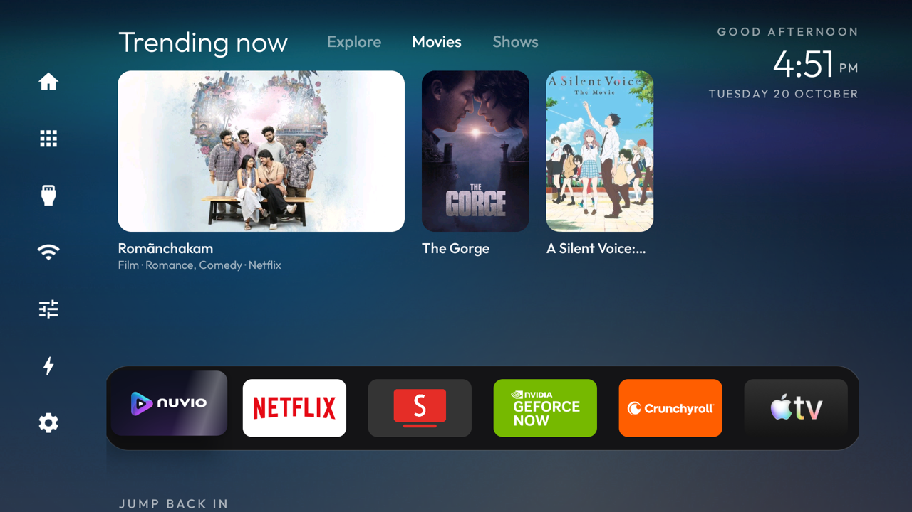

# Dante TV

A tvOS-style home screen for Android TV and Google TV, with a Top Shelf of what's trending on your
streaming services, a left menu rail and a remote-button quick settings panel. It also includes the
tools to debloat the TV. **No root, nothing uninstalled, and a one-line restore.**



Built and tested on a Philips Smart 4K Google TV (Skyworth eleonas, Google TV 14, 1.8 GB RAM).
It's a fork of [Gathin23/cleanyourtv](https://github.com/Gathin23/cleanyourtv), which did the
debloat tooling and the original launcher.

## What you get

**Home**
- **Left menu rail** with Home, All Apps, Inputs, Wi-Fi, Quick, Optimize and Settings. Press Left from anywhere on Home to open it.
- **Top Shelf** above the dock shows the Netflix Top 10 for your country plus Apple TV and Crunchyroll picks from TMDB. It has Explore, Movies and Shows tabs and rotates every 5 minutes.
- **Six-app dock**, plus a **Jump back in** row of the apps you opened last.
- **tvOS focus motion**: tiles tilt, drift and catch a glint when you focus them.
- **Aurora wallpaper with a moving sky**, a clock and greeting at the top right, and an Aurora screensaver.

**Panels that open in place, no jumping into the TV's settings screens**
- **All Apps** opens as a Launchpad-style grid.
- **Wi-Fi** lists nearby networks. Saved and open networks join directly, and secured ones ask for the password.
- **Inputs** lists HDMI ports with the names you gave them in Settings, their connection state, and Live TV.
- **Quick** has a sleep timer (hold OK to sleep now), Picture & sound, and Bluetooth headphones.
- **Optimize** frees RAM by force-stopping background apps, then shows how much it freed.

**The remote's ⚙ button** opens a quick settings panel from the right edge, over any app. It has
Wi-Fi, Bluetooth and Inputs lists inside the panel, Picture, Sound, the sleep timer, Optimize and
All settings. Optimize from here leaves the app you're watching running. Home or Back closes it.

**Arranging apps**: hold OK on a tile and choose Move, then use the arrows and press OK to drop it.
To reset the order, hold OK on Settings and choose Reset app order.

**Safety net**: if Home crashes 3 times in 5 minutes it starts in safe mode, without the shelf.
If the TV switches the accessibility services off, Home turns them back on by itself.

## Setting up the Top Shelf

The shelf uses [TMDB](https://www.themoviedb.org) for posters, and each TV needs its own free key.
No key ships with the app.

1. Get a key at themoviedb.org → Settings → API. Either the API key or the Read Access Token works.
2. On the TV, hold OK on **Settings** in the rail and choose **Top Shelf setup**.
3. Scan the QR code with your phone, which must be on the same Wi-Fi, and paste the key. The TV checks the key and saves it.

The region comes from the TV's country setting. The Netflix Top 10 comes from Netflix's public
Tudum data and needs no key. The key is stored only in the app's private storage on the TV.

## Install

You need a computer on the same Wi-Fi as the TV, JDK 17 and the Android SDK (platform 34). On macOS:

```bash
brew install openjdk@17 android-commandlinetools
sdkmanager "platforms;android-34" "build-tools;34.0.0"
```

**On the TV:** Settings → System → About → press OK on **Build** seven times. Then go to Developer
options and turn on **Wireless debugging** (Google TV) or USB/Network debugging (Android TV).

```bash
adb pair <tv ip>:<pairing port>                 # Google TV wireless debugging, once
adb connect <tv ip>:<port>
TV_HOST=<tv ip> INPUT_KEY_SERVICE=1 launcher/build-and-install.sh
```

Then grant the one permission that lets Home turn its accessibility services on, now and whenever
the TV switches them off. Press Home once afterwards:

```bash
adb shell pm grant com.gathin.tvhome android.permission.WRITE_SECURE_SETTINGS
```

| Service | What it does |
|---|---|
| Dante TV (InputKeyService) | The remote's ⚙ opens the quick settings panel and the Input button opens the input switcher. Every other key passes through. |
| Dante TV Optimize | Presses Force stop in TV Settings for each background app, under a cover screen. It only acts while Optimize runs. |

The app targets SDK 28, which lets it join Wi-Fi networks and connect Bluetooth headphones directly.

**Configure** dock apps, hidden apps, the Live TV package and the column count in
[`config.xml`](launcher/app/src/main/res/values/config.xml), or push a theme without rebuilding
using `tools/theme.sh themes/aurora`.

## Debloating

The tools from cleanyourtv still work. They need Python 3 only:

```bash
python3 -m venv tools/venv && tools/venv/bin/pip install -r tools/requirements.txt
export TV_HOST=<tv ip>

tools/venv/bin/python -I tools/tv.py --probe                 # model, Android version, firmware
tools/disable.sh examples/<your tv>/debloat.txt              # disable a list of packages
tools/restore.sh examples/<your tv>/debloat.txt              # undo it
```

[`examples/`](examples/) has tested lists for 66 TV models. Packages are disabled with
`pm disable-user`, not removed, so restore brings everything back. If your TV isn't listed, paste
[`PROMPT.md`](PROMPT.md) into a coding assistant and it will find the bloat on your TV.

## Restoring

```bash
TV_HOST=<tv ip> tools/restore.sh examples/<your tv>/debloat.txt com.google.android.apps.tv.launcherx  # Google TV
```

This re-enables the listed packages and puts the stock launcher back as Home. Dante TV stays
installed; remove it from Settings → Apps if you want it gone.

Common problems are covered in [docs/TROUBLESHOOTING.md](docs/TROUBLESHOOTING.md). The one most
likely to catch you: **on Google TV, only disable the stock launcher after Dante TV is installed
and running**, or Home lands on a broken setup screen.

## Credits

- [Gathin23/cleanyourtv](https://github.com/Gathin23/cleanyourtv): debloat tools, TV lists and the original launcher.
- [simbasjungles/free-my-tv](https://github.com/simbasjungles/free-my-tv): inspiration for the shelf card style.
- Movie and show data from [TMDB](https://www.themoviedb.org). This product uses the TMDB API but is not endorsed or certified by TMDB.
- [Outfit](https://fonts.google.com/specimen/Outfit) typeface, SIL Open Font License.

## Licence

MIT, see [`LICENSE`](LICENSE). The Outfit typeface is under the SIL Open Font License, see
`launcher/FONT-LICENSE-OFL.txt`.
